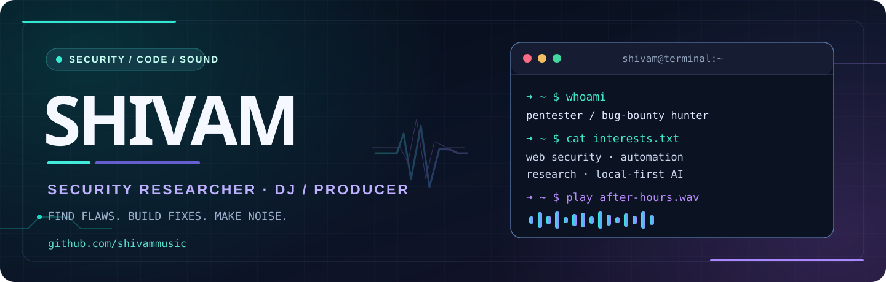

  

   

  

  

    
    
    
  

  
<strong>Think like an attacker. Build like an engineer. Create like an artist.</strong>

---

## `01 // whoami`

I'm **Shivam** — a penetration tester, security researcher, and builder exploring the intersection of **offensive security, automation, and AI**. I enjoy turning a messy surface into a clear attack-path hypothesis, validating findings carefully, and building tools that make repeatable research easier.

When the terminal closes, I switch to synths, rhythms, and music production. Different tools. Same curiosity. 🎛️

- 🔐 **Security:** web application pentesting, API security, access-control testing, and responsible disclosure.
- 🧰 **Engineering:** Python tooling, recon workflows, Docker, Linux, and developer automation.
- 🧠 **Exploring:** practical AI-assisted security workflows and privacy-conscious, local-first software.
- 🎵 **Beyond code:** DJing, sound design, and electronic music production.

> **Approach:** Explore deeply. Test within authorization. Document precisely. Make things safer.

## `02 // projects.exe`

<table>
  <tr>
    <td width="50%" valign="top">
      <h3>📬 <a href="https://github.com/shivammusic/steady-inbox">Steady Inbox</a></h3>
      
A privacy-conscious, local-first app that groups repeated notes by semantic similarity, keeps original messages visible, and exports a reviewable digest.

      
<code>Python</code> <code>ONNX Runtime</code> <code>Embeddings</code> <code>Local AI</code>

    </td>
    <td width="50%" valign="top">
      <h3>🛰️ <a href="https://github.com/shivammusic/Guide-to-SSRF">Guide to SSRF</a></h3>
      
A curated security-research reference covering server-side request forgery fundamentals, prevention, techniques, tools, and writeups.

      
<code>Web Security</code> <code>SSRF</code> <code>Research</code>

    </td>
  </tr>
  <tr>
    <td width="50%" valign="top">
      <h3>🔎 <a href="https://github.com/shivammusic/GitDorkWordlist">GitDorkWordlist</a></h3>
      
A compact collection for exploring GitHub search patterns during authorized security research.

      
<code>Recon</code> <code>OSINT</code> <code>Security</code>

    </td>
    <td width="50%" valign="top">
      <h3>📚 <a href="https://github.com/shivammusic/ResourceByShivammusic">Research Resources</a></h3>
      
A personal library of security-learning links and writeups, organized for quick reference.

      
<code>Notes</code> <code>References</code> <code>Learning</code>

    </td>
  </tr>
</table>

  

## `03 // toolbox`

**Security & research**

**Code & automation**

**Creative side**

## `04 // selected-disclosure`

**Access controls matter — especially when an endpoint says “access denied.”**

A publicly disclosed HackerOne report examines an **IDOR / information-disclosure issue** in a report-reference endpoint, where an error response exposed information that should not have been returned.

🔗 **[Read the disclosed HackerOne report (#3862641)](https://hackerone.com/reports/3862641)**

*Security research is performed with authorization and within applicable program scope.*

## `05 // github-pulse`

  
  
   
  

  
<strong>🎚️ After hours: music mode</strong>

   
  
I spend time behind keyboards, MIDI controllers, and production tools — chasing the perfect groove with the same persistence I bring to a security investigation.

  <pre>SECURITY  ▰▰▰▰▰▰▰▰▰▰  |  CODE  ▰▰▰▰▰▰▰▰░░░  |  MUSIC  ▰▰▰▰▰▰▰▰▰▰</pre>

---

  
<strong>Connect, collaborate, or share a good track.</strong>

  <a href="https://github.com/shivammusic">GitHub</a> · <a href="https://www.linkedin.com/in/shivammusic/">LinkedIn</a> · <a href="https://hackerone.com/shivammusic">HackerOne</a>
    
  ⚡ Curiosity-driven research, thoughtful engineering, and late-night beats.

